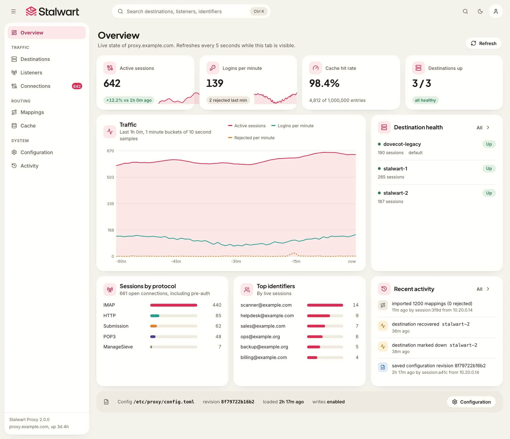

<p align="center">
    <a href="https://stalw.art">
    
    </a>
</p>

<h3 align="center">
  Multi-protocol mail proxy for Stalwart
</h3>

<br>

<p align="center">
  <a href="https://github.com/stalwartlabs/proxy/actions/workflows/ci.yml"></a>
  &nbsp;
  <a href="https://www.gnu.org/licenses/agpl-3.0"></a>
  &nbsp;
  <a href="https://stalw.art/docs/cluster/proxy/"></a>
</p>
<p align="center">
  <a href="https://mastodon.social/@stalwartlabs"></a>
  &nbsp;
  <a href="https://twitter.com/stalwartlabs"></a>
</p>
<p align="center">
  <a href="https://discord.com/servers/stalwart-923615863037390889"></a>
  &nbsp;
  <a href="https://www.reddit.com/r/stalwartlabs/"></a>
</p>

## Features

The Stalwart proxy sits in front of one or more mail servers and routes every connection to the right one per account, using the credentials the client already presents. In a Stalwart cluster it pins each account to one node so the node's caches stay warm; during a migration it lets an old and a new server (Dovecot, Cyrus, an older Stalwart) run side by side while accounts move one at a time, without reconfiguring clients and without downtime.

- **Multi-protocol.** IMAP, POP3, ManageSieve, SMTP submission and HTTP (JMAP, WebDAV, WebSocket), plus SMTP and LMTP pass-through.
- **Per-account routing.** Mapping store in a file, Redis or SQL (PostgreSQL, MySQL, SQLite), with an in-memory cache and a default destination.
- **Credential-aware.** Routing identifier from SASL `PLAIN`, `LOGIN`, `OAUTHBEARER` and `XOAUTH2`, HTTP Basic and Bearer, JWT and Stalwart token claims; authentication is replayed to the backend and never stored.
- **Client address forwarding.** PROXY protocol, or `XCLIENT` and IMAP `ID` for Dovecot and Postfix, plus `Forwarded` headers for HTTP.
- **TLS on both legs.** SNI certificate selection inbound; implicit TLS, STARTTLS, pinned certificates and mutual TLS towards backends.
- **Resilient.** Per-destination circuit breaker, retries, loop prevention and graceful draining.
- **Web interface and API.** Live traffic, destination health, sessions, mappings and cache; account moves with kicks and login delays; configuration editing and certificate upload, validated and applied live without a restart.
- **Locked-down management plane.** TLS only, token or browser sessions, per-address lockout, an operator allowlist and a configuration history.

<p align="center">
  <picture>
    <source media="(prefers-color-scheme: dark)" srcset="./img/dashboard-dark.webp">
    
  </picture>
</p>

## Quick start

With Docker, mount an empty directory owned by uid 2000, publish the management port on the loopback interface only, and publish the mail ports the listeners will use:

```bash
docker run -d --name proxy -v /srv/proxy:/etc/proxy -p 127.0.0.1:9443:9443 \
  -p 25:25 -p 143:143 -p 993:993 -p 110:110 -p 995:995 -p 587:587 -p 465:465 -p 4190:4190 -p 443:443 \
  ghcr.io/stalwartlabs/proxy:latest
```

On a Linux or macOS host, use the install script:

```bash
curl --proto '=https' --tlsv1.2 -sSf https://raw.githubusercontent.com/stalwartlabs/proxy/main/install.sh | sudo sh
```

Both create a minimal configuration with only the management interface, at `https://127.0.0.1:9443/ui/`, and print where the admin token is. Destinations, mappings and listeners are then added from the web interface. Keep the management port on the loopback interface or a trusted management network: inside a container it binds `0.0.0.0:9443`, which every container on the same Docker network can reach.

## Documentation

All documentation is available at [stalw.art/docs/cluster/proxy](https://stalw.art/docs/cluster/proxy/).

## Support

If you are having problems running Stalwart, found a bug, or just have a question, please head to the [Stalwart Support Portal](https://support.stalw.art) at [support.stalw.art](https://support.stalw.art). 
Additionally, you may purchase an [Enterprise License](https://stalw.art/enterprise) to obtain priority support from Stalwart Labs LLC, including response-time commitments and a private Priority Support area on the portal.

## License

This project is dual-licensed under the **GNU Affero General Public License v3.0** (AGPL-3.0; as published by the Free Software Foundation) and the **Stalwart Enterprise License v2 (SELv2)**:

- The [GNU Affero General Public License v3.0](./LICENSES/AGPL-3.0-only.txt) is a free software license that ensures your freedom to use, modify, and distribute the software, with the condition that any modified versions of the software must also be distributed under the same license. 
- The [Stalwart Enterprise License v2 (SELv2)](./LICENSES/LicenseRef-SEL.txt) is a proprietary license designed for commercial use. It offers additional features and greater flexibility for businesses that do not wish to comply with the AGPL-3.0 license requirements. 

Each file in this project contains a license notice at the top, indicating the applicable license(s). The license notice follows the [REUSE guidelines](https://reuse.software/) to ensure clarity and consistency. The full text of each license is available in the [LICENSES](./LICENSES/) directory.

## Copyright

Copyright (C) 2020, Stalwart Labs LLC
